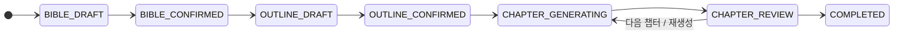

# StoryForge

사용자 프롬프트로부터 **일관된 장편 소설**을 만드는 AI 웹 플랫폼입니다.

```
Story Bible 생성/관리 → Outline 생성 → 순차 챕터 생성 + Continuity Tracking
```

단계마다 사용자 검토와 AI 자동 검증을 거칩니다. 자세한 배경은 [기획서](docs/plan/Proposal/StoryForge_기획서_v1.2.md)(문서 버전 1.3)를 보세요.

> **상태**: 기초 구현을 마친 개발 단계입니다. 정식 릴리스는 아직 없고, 실제 Claude 연동은 검증하지 못해 AI는 기본적으로 mock 공급자로 동작합니다. 라이선스는 [독점(All rights reserved)](LICENSE)입니다.

## 주요 기능

| 단계 | 하는 일 | AI | 사용자 |
|------|---------|----|--------|
| **Story Bible** | 세계관, 캐릭터, 테마, 톤을 만들고 관리 | 아이디어로 초안 생성 | 편집, 버전 비교, 확정 |
| **Outline** | 챕터별 Beats, 등장 캐릭터, 연속성 포인트 구성 | 챕터 수만큼 생성 | 드래그 앤 드롭 재배치, 편집, 확정 |
| **챕터** | Bible + Outline + 이전 챕터 요약으로 순차 생성 | 스트리밍 생성, 요약, Continuity 검증 | 리포트 확인, 편집, 승인·재생성 |
| **내보내기** | 승인된 챕터를 원고 파일로 | — | Markdown · TXT · DOCX · PDF · HTML · EPUB · ODT · RTF |

완성한 작품은 게시판에 올립니다. 자세한 내용은 [커뮤니티 스펙](docs/plan/community.md)에 있습니다.

| 기능 | 내용 |
|------|------|
| **게시판** | 롱품, 숏품, 패키지포지, 창작하기(라운지 포함), 이슈. 읽기는 로그인 없이 가능 |
| **작업 그래프** | 수동·에이전트 비율, 날짜별 막대, git 형식 작업 기록표. 막대는 그날 작업, 점은 기록 문단 |
| **함께 창작** | 초대를 수락한 사람만 원고를 공유. 작업 커밋으로 고친 구간을 적고, 점을 누르면 그 문장이 표시됨 |
| **활동 잔디** | 날짜 칸을 누르면 그날 기록 문단이 열림 |
| **Clone** | 세계관, 플롯, 전체 원고 범위로 내 프로젝트를 만들어 이어 쓰기. 원본 비교, 파생작 트리 |
| **공유 그래프** | 누가, 어디에 공유했고 몇 명이 들어왔는지 |
| **패키지포지** | 작품을 유니버스, 옴니버스, 사가 등으로 묶기. 연결 지도, 통합 인물 사전, 통합 내보내기 |
| **프로필** | 활동 잔디, 활동 내역, 업적, 계정 설정 |
| **AI 가이드챗** | 명령어로 안내와 화면 이동 |
| **신고와 관리** | 신고, 숨김·복원, 계정 정지, 차단, 이용약관, 알림 |

설정 망각을 막기 위해 챕터마다 앞선 설정과 요약을 컨텍스트로 넣고, 설정 충돌·캐릭터 일관성·타임라인·플롯 스레드를 검증한 결과를 사용자에게 보여 줍니다. 사람이 고친 원고는 승인할 때 요약과 검증을 다시 합니다. **사용자 검토를 건너뛰는 자동 승인은 없습니다.**



전이 규칙과 실패 시 복귀는 [pipeline-state-machine.md](docs/Architecture/pipeline-state-machine.md)에 있습니다.

## 기술 스택

| 영역 | 기술 |
|------|------|
| 프론트엔드 | Angular 21, Angular Material, TipTap, RxJS |
| 백엔드 | Spring Boot 4.1 (Java 21), Spring Security(JWT), Flyway, PostgreSQL 16 |
| AI 서비스 | FastAPI, Pydantic, Jinja2, Ollama(`gemma4:e4b`) + Anthropic SDK (개발 기본 `mock`) |
| 개발 환경 | Docker Compose(DB), Maven Wrapper |

버전과 포트의 기준값은 [CURRENT_STACK.md](docs/plan/CURRENT_STACK.md)입니다.

---

## 빠른 실행 (전체 스택)

### 1. 준비물

| 도구 | 버전 | 확인 명령 |
|------|------|-----------|
| Docker Desktop | 실행 중일 것 | `docker info` |
| Node.js | 24.14 이상 | `node -v` |
| JDK | 21 이상 | `java -version` |
| Python | 3.10 이상 | `python --version` |

Maven과 Angular CLI는 따로 설치하지 않아도 됩니다 (Maven Wrapper, `npx` 사용).

### 2. 실행 순서

터미널 4개를 열고 저장소 루트에서 순서대로 실행합니다. 각 서비스의 자세한 옵션은 아래 "서비스별 안내"의 README에 있습니다.

```bash
# ① DB — PostgreSQL 16 (호스트 포트 5433)
docker compose up -d

# ② AI 서비스 — http://127.0.0.1:8001 (처음 한 번만 venv 생성·설치)
cd storyforge-ai
python -m venv .venv
.venv/Scripts/python -m pip install -r requirements.txt
.venv/Scripts/python -m uvicorn app.main:app --host 127.0.0.1 --port 8001

# ③ 백엔드 — http://localhost:8080 (Flyway가 스키마를 자동 생성)
cd storyforge-backend
./mvnw spring-boot:run

# ④ 프론트엔드 — http://localhost:4200 (처음 한 번만 npm install)
cd storyforge-frontend
npm install
npx ng serve
```

> macOS/Linux에서는 `.venv/Scripts/python` 대신 `.venv/bin/python`을 씁니다.
> Windows PowerShell·cmd에서는 `./mvnw` 대신 `.\mvnw.cmd`를 씁니다.

### 3. 동작 확인

| 확인 | 명령 / 주소 | 기대 결과 |
|------|-------------|-----------|
| AI 서비스 | `curl http://127.0.0.1:8001/health` | `{"status":"ok","provider":"mock",...}` |
| 백엔드 | `curl http://localhost:8080/actuator/health` | `{"status":"UP"}` |
| API 문서 | http://localhost:8080/swagger-ui.html | Swagger UI |
| 웹 화면 | http://localhost:4200 | 로그인 화면 (회원가입 후 대시보드) |

`health`가 JSON이 아니거나 포트 사용 중 오류가 나면 [local-port-conflicts.md](docs/repeater/local-port-conflicts.md)를 보세요.

화면에서 **회원가입 → 새 프로젝트 → Story Bible 생성·확정 → Outline 생성·확정 → 챕터 생성**까지 진행하면, "AI writing..." 표시와 함께 본문이 흘러나오고 우측에 Continuity 점수가 나옵니다. 챕터를 승인한 뒤 **게시** 탭에서 올리면 게시판에 나옵니다.

신고를 처리할 관리자는 백엔드를 `ADMIN_EMAILS=이메일`로 실행해 지정합니다. 게시, Clone, 신고를 확인하는 절차는 [community-guide.md](docs/guidance/community-guide.md)에 있습니다.

### 4. 실제 Claude로 생성하기

기본값은 API 키 없이 동작하는 **mock 생성기**입니다. 생성물에는 "※ 개발용 mock 생성기 출력입니다"라는 표시가 붙습니다. Claude를 쓰려면 ② 단계를 이렇게 실행합니다.

```bash
LLM_PROVIDER=anthropic ANTHROPIC_API_KEY=sk-ant-... \
  .venv/Scripts/python -m uvicorn app.main:app --host 127.0.0.1 --port 8001
```

PowerShell에서는 `$env:LLM_PROVIDER="anthropic"; $env:ANTHROPIC_API_KEY="sk-ant-..."`를 먼저 실행합니다.

### 5. 종료와 초기화

| 하려는 일 | 명령 |
|-----------|------|
| 서비스 종료 | 각 터미널에서 `Ctrl+C` |
| DB 컨테이너 종료 (데이터 유지) | `docker compose down` |
| DB 데이터까지 삭제 | `docker compose down -v` |

---

## 독립 운영 콘솔

`storyforge-console`에서 `npm ci`, `npm start`를 실행하면 `http://localhost:4201`에 접속할 수 있습니다. `ADMIN_EMAILS`의 기존 계정만 로그인할 수 있습니다. [운영 가이드](docs/guidance/operations-console.md)와 [Gemma 응답 지연 조정](docs/guidance/ollama-performance.md)을 참고하세요.

## 서비스별 안내

| 서비스 | 기술 | 포트 | 실행 안내 |
|--------|------|------|-----------|
| 프론트엔드 | Angular 21 + Angular Material | 4200 | [storyforge-frontend/README.md](storyforge-frontend/README.md) |
| 운영 콘솔 | Angular 21 | 4201 | [storyforge-console/README.md](storyforge-console/README.md) |
| 백엔드 (Orchestrator) | Spring Boot 4.1 + PostgreSQL | 8080 | [storyforge-backend/README.md](storyforge-backend/README.md) |
| AI 서비스 | FastAPI + anthropic SDK | 8001 (내부 전용) | [storyforge-ai/README.md](storyforge-ai/README.md) |
| DB | PostgreSQL 16 (Docker) | 5433 | [docker-compose.yml](docker-compose.yml) |

```
브라우저 ──▶ Angular(4200) ──/api 프록시──▶ Spring Boot(8080) ──내부 HTTP──▶ FastAPI(8001) ──▶ LLM
                                              │
                                              ▼
                                       PostgreSQL(5433)
```

- **Angular는 FastAPI를 직접 호출하지 않습니다.** 모든 요청은 Spring Boot를 거칩니다.
- 버전·포트·환경 변수의 기준값은 [docs/plan/CURRENT_STACK.md](docs/plan/CURRENT_STACK.md)에 있습니다. 바꿀 때는 이 문서를 먼저 고칩니다.
- 환경 변수 목록은 [.env.example](.env.example)에 있습니다. 실제 값은 `.env`(커밋 금지)에 둡니다.

## 테스트

| 서비스 | 명령 (각 서비스 폴더에서) |
|--------|---------------------------|
| 백엔드 | `./mvnw test` (통합 테스트에 Docker 필요) |
| AI 서비스 | `.venv/Scripts/python -m pip install -r requirements-dev.txt` 후 `.venv/Scripts/python -m pytest -q` |
| 프론트엔드 | `npx ng test --watch=false`, **`npx ng build`** (단위 테스트는 화면 템플릿 오류를 놓칠 수 있음) |

2026-11-10 검증: 백엔드 82건, AI 50건, 운영 콘솔 8건입니다. 상세 결과와 브라우저 미검증 사항은 [검증 기록](docs/vaildates/operations-console-release.md)을 보세요. `develop`, `main`으로 가는 푸시와 PR에서 GitHub Actions([ci.yml](.github/workflows/ci.yml))가 네 서비스의 테스트와 두 Angular 앱의 `ng build`를 돌립니다.

## 현재 구현 범위

| 상태 | 항목 |
|------|------|
| ✅ 창작 | JWT 인증, 프로젝트 CRUD, Story Bible, Outline, 챕터 순차 생성(스트리밍), TipTap 에디터, Continuity 리포트, 고친 원고 재검증, 사용자 승인, 버전 이력·Diff, 프로젝트 설정, 함께 창작 |
| ✅ 커뮤니티 | 게시판 5종, 게시, 작업 그래프, Clone 3범위, 원본 비교·가져오기, 공유 그래프, 패키지포지와 전체 검사, 이슈, 프로필, 활동 잔디, 업적, 가이드챗, 내보내기 8종 |
| ✅ 운영 | 독립 콘솔, 운영 집계, 회원 검색·정지, 원자적 일괄 조치, 감사 기록, 신고, 관리자 처리, 숨김·복원, 계정 정지, 차단, 이용약관, 알림, Rate Limiting, Circuit Breaker, 다크/라이트 테마 |
| ⏸ 보류 | 실제 Claude API 연동 검증 (현재 mock 공급자로 동작). Codicomperchat 실제 연동 (규격 필요) |
| ⚠️ 공개 전 필요 | 이용약관 법률 검토, 이메일 인증·비밀번호 재설정 (메일 수단 결정 필요), 배포 구성 |

## 저장소 구조

```
StoryForge/
├── docs/plan/Proposal/         # 현재 기획 원본과 제3자 고지 위치 (기존 이동 이력 유지)
├── AGENTS.md                   # 작업 규칙 요약
├── LICENSE                     # 독점 (All rights reserved)
├── SECURITY.md                 # 보안 정책, 취약점 신고, 배포 전 체크리스트
├── CONTRIBUTING.md             # 기여 안내 (작업 규칙 요약)
├── CHANGELOG.md                # 변경 내역
├── .github/                    # PR 템플릿
├── .agents/                    # 규칙 정본 (skills/storyforge/SKILL.md)
├── .claude/ .cursor/ .codex/ .grok/ .antigravity/ .Manus/ .Gemini/ .Kimi/ .Ollama/ .Qwen/ .Opencode/ .Windsurf/   # 도구별 규칙 어댑터
├── docs/                       # 스펙, 아키텍처, 실행 가이드, 커밋 기록
├── storyforge-frontend/        # Angular SPA
├── storyforge-console/         # 독립 Angular 운영 콘솔
├── storyforge-backend/         # Spring Boot Orchestrator
├── storyforge-ai/              # FastAPI AI Service
├── docker-compose.yml          # 개발용 PostgreSQL
└── .env.example                # 환경 변수 키 목록
```

README는 서비스 루트와 핵심 기능 폴더에만 있습니다. 나머지 폴더의 설명은 가장 가까운 상위 README의 파일 표에 있습니다.

## 문서

| 문서 | 내용 |
|------|------|
| [StoryForge_기획서_v1.2.md](docs/plan/Proposal/StoryForge_기획서_v1.2.md) | 기획 원본. 모든 결정의 최우선 기준 |
| [docs/README.md](docs/README.md) | 문서 진입점 (폴더별 용도) |
| [docs/guidance/local-dev-setup.md](docs/guidance/local-dev-setup.md) | 로컬 실행 가이드 (문제 해결 포함) |
| [docs/plan/api-v1.md](docs/plan/api-v1.md) | API, SSE 이벤트, Continuity 리포트 형식 |
| [docs/plan/community.md](docs/plan/community.md) | 게시판, Clone, 공유, 패키지포지 스펙 |
| [docs/plan/moderation.md](docs/plan/moderation.md) | 신고, 관리자, 차단, 약관, 알림 스펙 |
| [docs/guidance/community-guide.md](docs/guidance/community-guide.md) | 관리자 지정과 커뮤니티 확인 절차 |
| [docs/Architecture/](docs/Architecture/) | 시스템 구조, 상태 머신 |
| [AGENTS.md](AGENTS.md) / [.agents/skills/storyforge/SKILL.md](.agents/skills/storyforge/SKILL.md) | 작업 규칙 요약 / 정본 |
| [docs/plan/roadmap-progress.md](docs/plan/roadmap-progress.md) | 작업 순서, 결정 사항, 진행 방식 변경 이력 |
| [CHANGELOG.md](CHANGELOG.md) | 변경 내역 |

## 기여 규칙 요약

1. 지정된 작업 브랜치(현재 `feature/auth`)에서 작업합니다. 브랜치를 임의로 추가하지 않습니다.
2. 커밋 메시지는 `type(scope): 한국어 요약` 형식입니다.
3. 커밋 기록([docs/branchs/commits/](docs/branchs/commits/))은 필요할 때만 남깁니다.
4. 병합은 `git merge --no-ff`로만 하고, 흐름은 `feature → develop → main`입니다. `main`이 기본 브랜치이며, `main` 반영은 사용자의 직접 명령이 있을 때만 합니다.

세부 규칙은 [CONTRIBUTING.md](CONTRIBUTING.md)와 [AGENTS.md](AGENTS.md)를 보세요.

## 보안

취약점은 **공개 이슈로 올리지 말고** [SECURITY.md](SECURITY.md)의 절차대로 비공개로 신고해 주세요. 운영하기 전에 같은 문서의 "알려진 제한"과 "배포 전 체크리스트"를 꼭 확인하세요. 특히 `JWT_SECRET`과 DB 비밀번호는 개발 기본값으로 운영하면 안 됩니다.

`LLM_PROVIDER=anthropic`이면 사용자의 소설 내용이 외부 LLM 제공자에게 전송됩니다.

## 라이선스

Copyright © 2026 StoryForge Project Team. **All rights reserved.** 서면 허락 없이 사용·복사·수정·배포할 수 없습니다. 자세한 내용은 [LICENSE](LICENSE)를, 사용 중인 오픈소스와 글꼴의 라이선스는 [THIRD_PARTY_NOTICES.md](docs/plan/Proposal/THIRD_PARTY_NOTICES.md)를 보세요.
