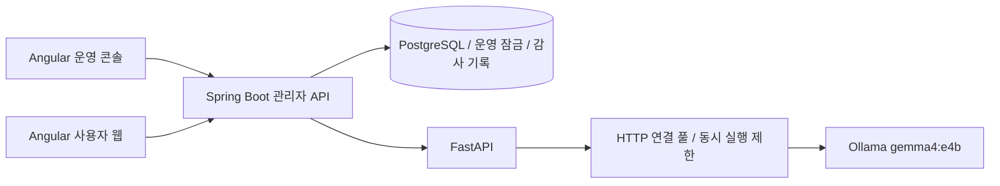

# 운영 콘솔과 추론 처리

> 2026-11-10 사용자 요청에 따른 확장. 기획 원본과 창작 상태 머신은 유지합니다.

`storyforge-console`은 독립 Angular 앱입니다. 로그인 후 `/auth/me`의 관리자 여부를 확인하며, 모든 데이터는 Spring Boot `/api/v1/admin`으로 요청합니다. 서버도 각 작업에서 관리자 설정을 다시 확인합니다.

운영 현황은 집계 쿼리로 조회합니다. 회원 검색과 감사 기록은 서버에서 페이지 처리합니다. 신고 일괄 조치는 최대 50건을 하나의 트랜잭션으로 처리하며 실패하면 전체를 되돌립니다. 기존 신고 화면의 조치를 포함하여 숨김·복원·기각·정지·해제를 감사 테이블에 추가합니다. 감사 기록에는 관리자 ID, 표시명, 대상, 조치, 사유, 시간이 남고 수정·삭제 API는 제공하지 않습니다.

운영 조치 전용 잠금 행을 트랜잭션 종료까지 잠가 단일·일괄 조치의 경합을 직렬화합니다. 이미 처리된 신고를 다시 닫으면 409입니다. 일괄 요청에서 같은 대상의 신고는 한 번만 처리합니다. 다른 요청에서 이루어진 변경은 충돌로 돌려줍니다. 회원 정지는 기존 로그인·쓰기 차단과 알림 정책을 따릅니다.

같은 작성자의 여러 대상에 정지·해제를 적용하면 요청 내부에서 변경한 계정 ID를 공유해 계정 상태 변경과 작성자 알림은 한 번만 실행합니다. 대상별 신고 처리와 감사 기록은 각각 남깁니다. 공유 범위는 한 트랜잭션이며 다른 요청의 상태 충돌을 허용하지 않습니다. 공백만 있는 Ollama 스트림은 완료 신호가 있어도 빈 응답 오류로 처리합니다.

FastAPI는 Ollama HTTP 연결 풀을 재사용합니다. 모델 상주 시간과 선택적 시작 예열로 로딩 지연을 줄이고, JSON 스키마를 전달해 구조화 응답을 검증합니다. 생성 동시 실행 수와 대기 시간을 제한하며 연결 종료·잘린 출력·잘못된 응답은 실패로 처리합니다. Story Bible, Outline, 이전 요약과 Continuity 검증은 생략하지 않습니다. 하드웨어 실측 전에는 응답 시간 개선 수치를 보장하지 않습니다.

