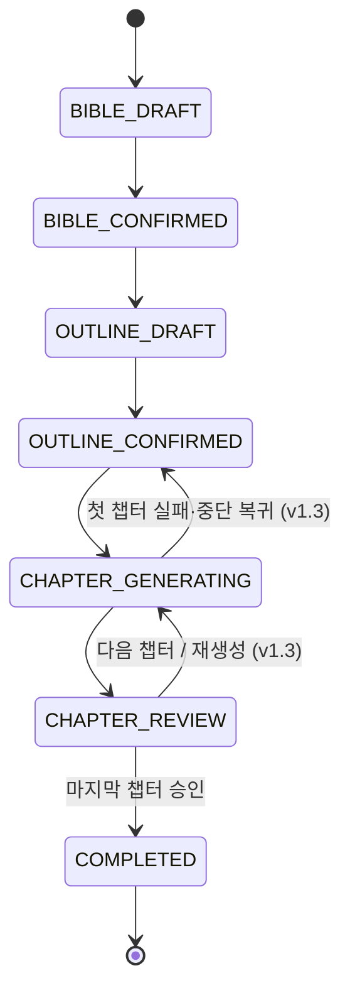

# 파이프라인 상태 머신 (프로젝트 단위)

> 기준: 기획서 v1.3 §7.2 — **임의 변경 금지** (정본 §0, "상태 머신")
> 상태 이름과 순서는 원본 그대로입니다. 바꾸려면 먼저 사용자 승인을 받고 기획서 버전을 올립니다.

## 상태 순서

```
BIBLE_DRAFT → BIBLE_CONFIRMED → OUTLINE_DRAFT → OUTLINE_CONFIRMED
→ CHAPTER_GENERATING → CHAPTER_REVIEW → COMPLETED
```



둘째 챕터부터 생성이 실패하면 `CHAPTER_GENERATING → CHAPTER_REVIEW`로 돌아갑니다.

## Clone 프로젝트의 시작 상태 (2026-11-03)

새 프로젝트는 `BIBLE_DRAFT`에서 시작합니다. Clone한 프로젝트는 범위에 맞는 기존 상태에서 시작합니다. **상태와 전이는 추가하지 않았고**, 시작한 뒤의 전이는 위 규칙을 그대로 따릅니다.

| Clone 범위 | 시작 상태 | 이유 |
|-----------|-----------|------|
| 세계관 | `BIBLE_DRAFT` | Bible을 새 주인이 고치고 확정 |
| 플롯 | `OUTLINE_DRAFT` | Bible은 원작 그대로, Outline을 고치고 확정 |
| 전체 원고 | `CHAPTER_REVIEW` | 복제 원고는 모두 Draft. 앞 장부터 다시 승인 (검토를 건너뛰지 않음) |

게시(`publish`)는 상태를 바꾸지 않습니다. [community.md](../plan/community.md)

## 상태별 의미와 담당

| 상태 | 의미 | 상태를 바꾸는 주체 |
|------|------|--------------------|
| `BIBLE_DRAFT` | Story Bible 생성·편집 중 | Spring Boot (사용자 요청 → FastAPI 생성) |
| `BIBLE_CONFIRMED` | 사용자가 Story Bible을 확정 | Spring Boot |
| `OUTLINE_DRAFT` | Outline 생성·편집 중 | Spring Boot |
| `OUTLINE_CONFIRMED` | 사용자가 Outline을 확정 | Spring Boot |
| `CHAPTER_GENERATING` | 챕터 생성 + Continuity 검증 진행 중 | Spring Boot (생성은 FastAPI) |
| `CHAPTER_REVIEW` | 사용자 검토 대기. **건너뛰지 않습니다** | Spring Boot |
| `COMPLETED` | 프로젝트 완료 | Spring Boot |

상태 전이는 Spring Boot `service/orchestration/`에서만 일어납니다. Angular와 FastAPI는 상태를 바꾸지 않습니다.

## 별도 상태: Chapter (§10)

프로젝트 상태와 별개로, 각 Chapter 엔티티는 `DRAFT` / `CONFIRMED` 상태를 가집니다.
§7.2 6단계에 따라 사용자가 승인하면 Chapter가 `CONFIRMED`로 바뀌고 프로젝트 상태 머신이 갱신됩니다.

## 서버 재시작 시 복구

생성 도중 서버가 꺼져 `CHAPTER_GENERATING`에 남은 프로젝트는 시작할 때 v1.3 복귀 전이로 되돌립니다 ([stability.md](../plan/stability.md)).

## 미정 사항 (기획서에 정의 없음)

- 확정 후 되돌리기 (예: `BIBLE_CONFIRMED` → `BIBLE_DRAFT`) 허용 여부. 현재는 구현하지 않았고, 확정 후에는 Bible·Outline을 수정할 수 없습니다.

## 변경 이력

| 일자 | 변경 | 사유 |
|------|------|------|
| 2026-10-22 | 첫 구현에서 임시 전이 2개 추가 | 기획서에 다음 챕터 전이와 실패 복귀가 없어 동작에 필요 |
| 2026-11-02 | 임시 전이 2개를 기획서 v1.3 정식 전이로 승격 | 사용자 승인 |
