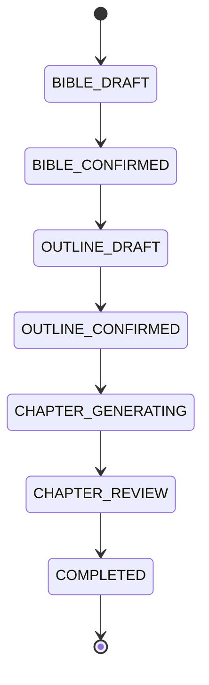

# 파이프라인 상태 머신 (프로젝트 단위)

> 기준: 기획서 v1.2 §7.2 — **임의 변경 금지** (정본 §0, "상태 머신")
> 상태 이름과 순서는 원본 그대로입니다. 바꾸려면 먼저 사용자 승인을 받고 기획서 버전을 올립니다.

## 상태 순서

```
BIBLE_DRAFT → BIBLE_CONFIRMED → OUTLINE_DRAFT → OUTLINE_CONFIRMED
→ CHAPTER_GENERATING → CHAPTER_REVIEW → COMPLETED
```



## 상태별 의미와 담당

| 상태 | 의미 | 상태를 바꾸는 주체 |
|------|------|--------------------|
| `BIBLE_DRAFT` | Story Bible 생성·편집 중 | Spring Boot (사용자 요청 → FastAPI 생성) |
| `BIBLE_CONFIRMED` | 사용자가 Story Bible을 확정 | Spring Boot |
| `OUTLINE_DRAFT` | Outline 생성·편집 중 | Spring Boot |
| `OUTLINE_CONFIRMED` | 사용자가 Outline을 확정 | Spring Boot |
| `CHAPTER_GENERATING` | 챕터 생성 + Continuity 검증 진행 중 | Spring Boot (생성은 FastAPI) |
| `CHAPTER_REVIEW` | 사용자 검토 대기. **건너뛰지 않습니다** | Spring Boot |
| `COMPLETED` | 프로젝트 완료 | Spring Boot |

상태 전이는 Spring Boot `service/orchestration/`에서만 일어납니다. Angular와 FastAPI는 상태를 바꾸지 않습니다.

## 별도 상태: Chapter (§10)

프로젝트 상태와 별개로, 각 Chapter 엔티티는 `DRAFT` / `CONFIRMED` 상태를 가집니다.
§7.2 6단계에 따라 사용자가 승인하면 Chapter가 `CONFIRMED`로 바뀌고 프로젝트 상태 머신이 갱신됩니다.

## 미정 사항 (기획서에 정의 없음 — 사용자 확인 필요)

아래 항목은 원본에 정의되어 있지 않아 다이어그램에 넣지 않았습니다. 결정되면 기획서 개정 또는 이 절 아래 추가로 반영합니다.

- 여러 챕터를 순차 생성할 때 `CHAPTER_REVIEW` → 다음 챕터 `CHAPTER_GENERATING`으로 돌아가는 전이 여부
- 확정 후 되돌리기 (예: `BIBLE_CONFIRMED` → `BIBLE_DRAFT`) 허용 여부
- 생성 실패, 타임아웃 등 오류 상태 처리 방식
