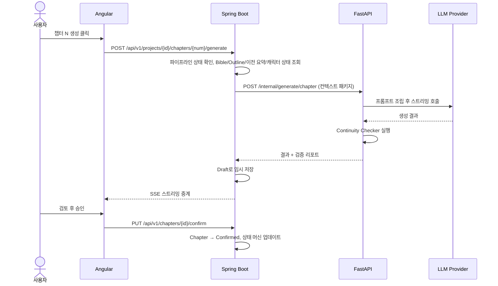

# 시스템 개요

> 기준: 기획서 v1.3 §7 (내용은 원본을 그대로 옮겼습니다. 원본이 바뀌면 이 문서를 맞춥니다.)

## 고수준 구조 (§7.1)

```
[Angular SPA]
    │ HTTPS (REST + SSE 스트리밍)
    ▼
[Spring Boot Orchestrator]
    │ - 인증/인가 (JWT)
    │ - 프로젝트/Bible/Outline/Chapter CRUD
    │ - 파이프라인 상태 머신
    │ - 트랜잭션 & 영속화 (PostgreSQL)
    │ - FastAPI 클라이언트 (WebClient)
    ▼
[FastAPI AI Service]
    │ - 프롬프트 조립 (템플릿 + 컨텍스트)
    │ - LLM 호출 (스트리밍)
    │ - Continuity 검증 에이전트
    ▼
[LLM Providers] (OpenAI, Anthropic 등)
```

## 서비스 책임 분리 (§7.3)

| 서비스 | 책임 | 비고 |
|--------|------|------|
| Angular | UI/UX, 사용자 인터랙션, 에디터, 상태 표시, SSE 수신 | Material 기반 |
| Spring Boot | 오케스트레이션, 비즈니스 규칙, 데이터 영속화, 보안, API 게이트웨이 | WebClient로 FastAPI 호출 |
| FastAPI | AI 파이프라인 실행, 프롬프트 엔지니어링, LLM 통신, 연속성 검증 로직 | 내부 전용 |

## 호출 규칙 (정본 "호출 및 책임 규칙")

- Angular는 FastAPI를 직접 호출하지 않습니다. 모든 요청은 Spring Boot를 거칩니다.
- FastAPI는 내부망 전용입니다. 로컬 실행은 `127.0.0.1`에만 묶고, 운영에서는 8001 포트를 밖에 열지 않습니다.
- 상태 머신과 오케스트레이션은 Spring Boot가 맡습니다.
- LLM 호출과 Continuity Check는 FastAPI에서만 합니다.

## 챕터 생성 흐름 (§7.2)

1. 사용자: Angular에서 "챕터 N 생성" 클릭
2. Angular → Spring Boot: `POST /api/v1/projects/{id}/chapters/{num}/generate`
3. Spring Boot:
   - 현재 파이프라인 상태 확인 (BIBLE_CONFIRMED, OUTLINE_CONFIRMED 여부)
   - 관련 데이터 조회 (Bible 항목, Outline, 이전 챕터 요약, 캐릭터 상태)
   - FastAPI에 컨텍스트 패키지 전달 (`POST /internal/generate/chapter`)
4. FastAPI:
   - 프롬프트 템플릿에 컨텍스트 주입
   - LLM 스트리밍 호출
   - 생성 완료 후 Continuity Checker 실행
   - 결과 + 검증 리포트 반환
5. Spring Boot:
   - 결과를 Draft 상태로 임시 저장
   - 프론트에 SSE로 스트리밍 중계
6. 사용자: 검토 후 승인 → Spring Boot가 Chapter를 Confirmed로 전환하고 상태 머신 업데이트



> 다이어그램은 §7.2의 번호 순서를 그대로 옮긴 것입니다. 스트리밍 중계의 실제 시점(생성 중 실시간 중계인지)은 구현 스펙에서 확정합니다.
> 승인 엔드포인트는 §11의 `PUT /api/v1/chapters/{id}/confirm`을 사용했습니다.

## 인증 (2026-11-02)

`/api/v1/**`는 JWT가 필요합니다. 토큰 검증은 Spring Security가, 프로젝트·챕터 소유자 검사는 `OwnershipInterceptor`가 합니다. FastAPI는 기존대로 내부 전용이라 인증을 하지 않습니다. 자세한 내용은 [../plan/auth.md](../plan/auth.md)를 보세요.

## 안정성·Should 기능 (2026-11-02)

AI 호출에는 타임아웃, 연결 실패 재시도, Circuit Breaker가 적용됩니다 ([stability.md](../plan/stability.md)). 내보내기와 버전 이력은 Spring Boot 안에서 처리하며 AI 서비스를 호출하지 않습니다 ([should-features.md](../plan/should-features.md)).

## 커뮤니티 (2026-11-03)

프로젝트(비공개 작업실)와 작품(공개 스냅샷)을 나눕니다. 게시는 승인된 챕터를 복사하며 파이프라인 상태를 바꾸지 않습니다. 작업 기록(`activity_event`)이 작업 그래프와 활동 잔디의 원본이고, 업적은 커밋 뒤에 계산합니다. 함께 창작은 `project_collaborator`와 `work_commit`으로 두고, 인용 문장은 참여자에게만 돌려줍니다. 커뮤니티 읽기 API만 로그인 없이 열려 있습니다. 가이드챗의 LLM 호출도 FastAPI에서만 합니다. [community.md](../plan/community.md)

## 안전장치와 알림 (2026-11-04)

요청은 `RateLimitFilter`(보안 필터) → `AccountGuardInterceptor`(쓰기 요청의 정지·삭제 계정 차단) → `OwnershipInterceptor`(프로젝트·챕터 접근) 순서로 지납니다. 신고와 관리자 조치는 글을 지우지 않고 숨깁니다. 알림은 원래 작업과 같은 트랜잭션에 묶입니다. [moderation.md](../plan/moderation.md)

```
승인 요청 ─▶ needsReview?
              ├ 아니오 ──────────────────────────────▶ 승인
              └ 예 ─▶ FastAPI /internal/generate/review
                        ├ 실패 ─▶ 502, 승인하지 않음
                        └ 성공 ─▶ 요약·리포트 저장
                                  ├ high 이슈 ─▶ 409, 사용자가 보고 다시 승인
                                  └ 없음 ─────▶ 승인
```

## 구현 메모 (2026-10-22)

- **스트리밍 시점**: FastAPI가 LLM 토큰을 받는 즉시 SSE로 보내고, Spring Boot는 이를 그대로 프론트에 중계합니다. 생성이 끝나면 FastAPI가 요약과 Continuity 검증을 실행해 `done` 이벤트로 보내고, Spring Boot가 이때 Draft로 저장합니다. (§7.2 4·5단계)
- **트랜잭션**: Spring Boot는 FastAPI 호출 동안 DB 트랜잭션을 잡지 않습니다. 상태 확인·컨텍스트 조립 → (AI 호출) → 저장·상태 전이를 각각 짧은 트랜잭션으로 나눕니다.
- **실패·중단**: AI 오류나 클라이언트 연결 종료 시 프로젝트 상태를 생성 전으로 되돌립니다. 전이 규칙은 [pipeline-state-machine.md](pipeline-state-machine.md)를 보세요.
- **모델 스트림 해제**: FastAPI의 SSE 생성기와 챕터 생성기는 내부 비동기 생성기를 명시적으로 닫습니다. 수신 중단이 모델 HTTP 스트림까지 전달되어 추론 슬롯을 가비지 컬렉션에 의존하지 않고 반환합니다.
- **완료 신호 누락**: AI 연결이 오류 없이 끝나더라도 `done`이 없으면 생성 실패입니다. 부분 토큰을 Draft로 저장하지 않고 `error`를 보내며 생성 전 상태로 복귀합니다.
- **프론트 SSE**: 생성 요청이 POST라 `EventSource` 대신 `fetch` 스트림으로 읽습니다 (`core/api/chapter-stream.service.ts`).
- **LLM 공급자**: 기본은 키 없이 동작하는 `mock`이고, `LLM_PROVIDER=ollama`이면 일반 출력은 Gemma이고 프로젝트가 `claude-*`를 지정하면 Claude로 라우팅합니다. `anthropic`은 모델 미지정 요청도 Claude를 기본 선택합니다.
- 엔드포인트와 이벤트 형식은 [../plan/api-v1.md](../plan/api-v1.md)에 있습니다.

## 운영 콘솔과 Ollama (2026-11-10)

독립 Angular `storyforge-console`도 Spring Boot만 호출합니다. 운영 조치는 공통 DB 잠금으로 직렬화하고 변경·알림·감사를 같은 트랜잭션에 묶습니다. FastAPI는 연결 풀과 추론 슬롯을 재사용하며 모델 상주·예열·스키마 검증을 지원합니다. [상세 구조](operations-console.md).

동일 작성자의 복수 대상 계정 조치는 일괄 트랜잭션 안에서만 공유해 계정 변경·작성자 알림을 중복하지 않습니다. 대상별 신고 처리와 감사 기록은 유지합니다. 공백뿐인 AI 스트림은 정상 완료로 저장하지 않습니다.

## 관련 문서

- [pipeline-state-machine.md](pipeline-state-machine.md)
- [../plan/api-v1.md](../plan/api-v1.md)
- [../plan/CURRENT_STACK.md](../plan/CURRENT_STACK.md)
# 실모델 검증 경계 (2026-11-10)

2026-11-11 생성 보강에서 프로젝트의 최초 창작 요구를 V14 `creative_brief`에 저장합니다. AI에 작품 형식과 전체 Outline, 직전 확정 장의 마지막 1,200자를 추가로 전달합니다. 실모델 본문 후처리는 요약과 Continuity 구조화 분석 한 번으로 수행하며 규칙 검사 결과를 합산합니다. 반복 루프는 스트리밍 중 감지해 오류로 종료합니다. 동시 신고 접수는 운영 잠금으로 관리자 조치와 직렬화합니다.

AI Outline 생성은 요청한 챕터 수와 결과 수가 일치해야 성공합니다. 불일치는 `LLMError`로 반환하며 부분 Outline을 정상 결과로 전달하지 않습니다.

`storyforge-ai/scripts/validate_pipeline.py`는 임시 인물 저장소에서 합성 작품을 생성하고 실제 요약·Continuity까지 실행합니다. 다음 장의 입력은 검증 프로세스 메모리 안에서만 조립하며 Spring Boot의 검토·승인·저장 흐름을 대체하지 않습니다. pytest 인물 저장소도 테스트별 임시 경로로 격리합니다.

## 계정 메일과 자격 증명 폐기

`MAIL_ENABLED=true`이면 관리자 권한은 설정 이메일 일치와 이메일 인증 완료를 함께 요구합니다. 미인증 계정은 일반 사용자 웹에서 인증한 뒤 콘솔에 로그인해야 합니다. 메일 비활성 환경은 기존 관리자 정책을 유지합니다.

Angular → Spring Boot → SMTP 순서로 처리합니다. FastAPI는 계정 메일에 관여하지 않습니다. V12는 이메일 인증 시각, 자격 증명 버전, 계정 낙관적 잠금 버전, 목적별 일회용 토큰 해시를 추가합니다. 메일 토큰 발급·소비는 사용자 행 잠금과 트랜잭션으로 직렬화하며, SMTP 실패 시 생성 토큰을 제거합니다. 전송 성공 직후 DB 커밋이 실패하면 메일 링크가 유효하지 않을 수 있으므로 사용자는 재요청해야 합니다. 비밀번호 변경 시 JWT의 자격 증명 버전과 DB 버전을 비교해 이전 세션을 거부합니다. [상세 계약](../plan/auth.md), [로컬 검증](../guidance/account-mail.md).

Ollama의 요청과 예열은 `OLLAMA_NUM_CTX`를 같은 값으로 사용합니다. 필수 컨텍스트를 잘라 성능을 맞추지 않으며, 메모리 사용량과 실제 모델 품질은 [성능 기록](../guidance/ollama-performance.md)에서 별도로 평가합니다.

## 챕터 분량·인물 검증 (후속 작업)

생성 프롬프트는 목표 분량(공백 포함 4,000~6,000자), Beat별 구체 장면, 등장인물 첫 등장 시 Outline 전체 이름 표기를 요청합니다. 강제 이어쓰기·자동 승인은 하지 않습니다. 기존 규칙 기반 분량 경고 기준 300자를 생성 목표의 하한 4,000자로 올려 짧은 결과를 검토 화면에 낮은 심각도 이슈로 표시합니다. 정확한 전체 이름이 없을 때는 인물 부재로 단정하지 않고 다른 호칭을 확인하라고 표시합니다. LLM 연속성 이슈는 근거와 완결된 설명을 요청하되 결과를 임의로 삭제하지 않습니다.

## 재검증과 동시 편집

V13은 챕터의 내부 낙관적 잠금 버전을 추가합니다. 승인 요청은 재검증할 본문과 버전을 짧은 트랜잭션에서 읽고, AI 호출 후 같은 버전의 Draft에만 요약·리포트를 적용합니다. 그 사이 본문을 바꾸거나 이전 내용으로 다시 저장한 경우에도 409로 거부합니다. 검증 결과를 저장하는 순간의 동시 수정도 JPA 버전 조건으로 감지합니다. 외부 응답 DTO와 사용자 검토 단계는 기존 계약을 따릅니다.

## 정적 진단 계약

수동 성능 측정·파이프라인 검증 도구는 `storyforge-ai/scripts/`, JVM 복구 검증 도구는 `storyforge-backend/scripts/`에 둡니다. 각 서비스 폴더에서 Python 모듈로 실행하며 제품 서버의 진입점과 분리합니다. 데이터·JAR 경로는 이동한 파일을 기준으로 서비스 루트를 찾아 사용합니다.

모델·mock·라우팅·챕터 스트림은 종료 가능한 `AsyncGenerator`로 선언해 `aclose()`와 `aclosing`의 계약을 타입 검사에서도 확인합니다. 검증 도구의 비동기 수집기는 결과와 첫 조각 시각을 명시적으로 반환하며 완료·본문·요약 누락은 실패입니다. ChromaDB 컬렉션 `characters`에는 이름 풀 225개의 글자 겹침 벡터가 들어 있습니다. 패키지가 없으면 이름 JSON 중복 방지는 그대로 동작합니다.

메일 토큰·감사·업적·추천의 SQL `COUNT` 결과는 명시적으로 필수 값으로 확인합니다. 비정상적으로 결과가 없을 때 0으로 간주해 후속 처리를 진행하지 않습니다. 클라이언트 IP 파싱은 기존 신뢰 프록시 규칙을 유지하며 단순 반복문으로 처리합니다.

## AI 서버 내부 실행 조정

실모델 챕터의 Beats가 3개 이상이면 두 구간으로 배분합니다. 각 구간의 모델 스트림은 즉시 SSE로 전달하며 뒤 구간은 앞 구간의 실제 본문 전체를 받습니다. 전체 분량 목표 5,000자에서 앞 구간의 길이를 뺀 값을 뒤 구간 목표로 사용합니다. 모든 구간과 요약·검증이 성공해야 done을 보냅니다. 구간 취소·반복 오류는 내부 모델 연결까지 즉시 전달합니다.

요청한 폴더 책임 분리를 위해 `storyforge-ai/main.py`를 정식 ASGI 진입점으로 두고 `app/orchestration.py`의 팩토리가 API·상태 확인·모델 수명주기를 조립합니다. 이전 `app.main:app`은 같은 인스턴스를 참조합니다. 실행 명령은 서비스 폴더에서 `python -m uvicorn main:app`입니다.

| 조정 파일 | 책임 |
|---|---|
| `app/api/orchestration.py`, `app/api/v1/orchestration.py` | HTTP 오류 계약과 라우터 그룹 등록 |
| `app/core/orchestration.py` | 모델 공급자 라우팅, 캐시된 클라이언트, 선택적 예열·종료 |
| `app/services/orchestration.py` | 요청별 `AiTaskOrchestrator`, 본문 스트림 → 요약 → Continuity → 결과 |
| `app/models/orchestration.py` | 공통 챕터 컨텍스트와 내부 Token·Done 이벤트 |
| `app/prompts/orchestration.py` | 공통 Jinja 환경과 템플릿 렌더링 |
| `scripts/orchestration.py` | 허용된 네 검증 도구 선택·인자 전달 |
| `tests/orchestration.py` | 자동 테스트 인물 저장소 격리 |

API는 의존성 주입으로 작업 조정기를 받고 개별 서비스는 상위 계층을 역참조하지 않습니다. 수동 파이프라인·반복 검증도 같은 작업 조정기를 사용합니다. 데이터 폴더에는 실행 조정 코드를 추가하지 않습니다. Spring Boot의 상태 머신·DB 저장·사용자 검토 단계와 기존 HTTP·SSE 계약은 유지합니다.

