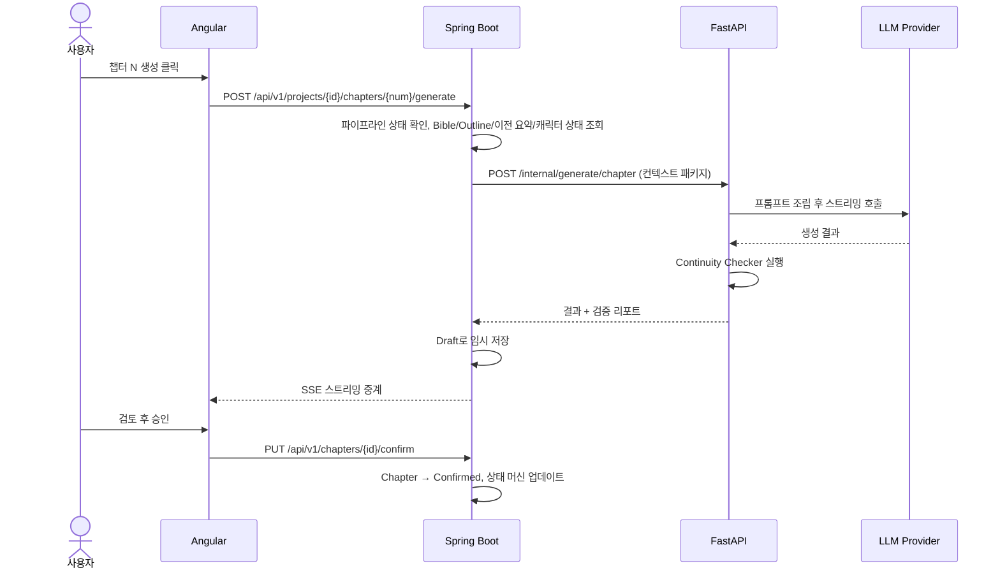

# 시스템 개요

> 기준: 기획서 v1.2 §7 (내용은 원본을 그대로 옮겼습니다. 원본이 바뀌면 이 문서를 맞춥니다.)

## 고수준 구조 (§7.1)

```
[Angular SPA]
    │ HTTPS (REST + SSE 스트리밍)
    ▼
[Spring Boot Orchestrator]
    │ - 인증/인가 (JWT)
    │ - 프로젝트/Bible/Outline/Chapter CRUD
    │ - 파이프라인 상태 머신
    │ - 트랜잭션 & 영속화 (PostgreSQL)
    │ - FastAPI 클라이언트 (WebClient)
    ▼
[FastAPI AI Service]
    │ - 프롬프트 조립 (템플릿 + 컨텍스트)
    │ - LLM 호출 (스트리밍)
    │ - Continuity 검증 에이전트
    ▼
[LLM Providers] (OpenAI, Anthropic 등)
```

## 서비스 책임 분리 (§7.3)

| 서비스 | 책임 | 비고 |
|--------|------|------|
| Angular | UI/UX, 사용자 인터랙션, 에디터, 상태 표시, SSE 수신 | Material 기반 |
| Spring Boot | 오케스트레이션, 비즈니스 규칙, 데이터 영속화, 보안, API 게이트웨이 | WebClient로 FastAPI 호출 |
| FastAPI | AI 파이프라인 실행, 프롬프트 엔지니어링, LLM 통신, 연속성 검증 로직 | 내부 전용 |

## 호출 규칙 (정본 "호출 및 책임 규칙")

- Angular는 FastAPI를 직접 호출하지 않습니다. 모든 요청은 Spring Boot를 거칩니다.
- FastAPI는 내부망 전용입니다.
- 상태 머신과 오케스트레이션은 Spring Boot가 맡습니다.
- LLM 호출과 Continuity Check는 FastAPI에서만 합니다.

## 챕터 생성 흐름 (§7.2)

1. 사용자: Angular에서 "챕터 N 생성" 클릭
2. Angular → Spring Boot: `POST /api/v1/projects/{id}/chapters/{num}/generate`
3. Spring Boot:
   - 현재 파이프라인 상태 확인 (BIBLE_CONFIRMED, OUTLINE_CONFIRMED 여부)
   - 관련 데이터 조회 (Bible 항목, Outline, 이전 챕터 요약, 캐릭터 상태)
   - FastAPI에 컨텍스트 패키지 전달 (`POST /internal/generate/chapter`)
4. FastAPI:
   - 프롬프트 템플릿에 컨텍스트 주입
   - LLM 스트리밍 호출
   - 생성 완료 후 Continuity Checker 실행
   - 결과 + 검증 리포트 반환
5. Spring Boot:
   - 결과를 Draft 상태로 임시 저장
   - 프론트에 SSE로 스트리밍 중계
6. 사용자: 검토 후 승인 → Spring Boot가 Chapter를 Confirmed로 전환하고 상태 머신 업데이트



> 다이어그램은 §7.2의 번호 순서를 그대로 옮긴 것입니다. 스트리밍 중계의 실제 시점(생성 중 실시간 중계인지)은 구현 스펙에서 확정합니다.
> 승인 엔드포인트는 §11의 `PUT /api/v1/chapters/{id}/confirm`을 사용했습니다.

## 구현 메모 (2026-10-22)

- **스트리밍 시점**: FastAPI가 LLM 토큰을 받는 즉시 SSE로 보내고, Spring Boot는 이를 그대로 프론트에 중계합니다. 생성이 끝나면 FastAPI가 요약과 Continuity 검증을 실행해 `done` 이벤트로 보내고, Spring Boot가 이때 Draft로 저장합니다. (§7.2 4·5단계)
- **트랜잭션**: Spring Boot는 FastAPI 호출 동안 DB 트랜잭션을 잡지 않습니다. 상태 확인·컨텍스트 조립 → (AI 호출) → 저장·상태 전이를 각각 짧은 트랜잭션으로 나눕니다.
- **실패·중단**: AI 오류나 클라이언트 연결 종료 시 프로젝트 상태를 생성 전으로 되돌립니다. 자세한 내용은 [pipeline-state-machine.md](pipeline-state-machine.md)의 "구현 임시안"을 보세요.
- **프론트 SSE**: 생성 요청이 POST라 `EventSource` 대신 `fetch` 스트림으로 읽습니다 (`core/api/chapter-stream.service.ts`).
- **LLM 공급자**: 기본은 키 없이 동작하는 `mock`이고, `LLM_PROVIDER=anthropic`이면 Claude(`claude-opus-5-5`)를 씁니다.
- 엔드포인트와 이벤트 형식은 [../plan/api-v1.md](../plan/api-v1.md)에 있습니다.

## 관련 문서

- [pipeline-state-machine.md](pipeline-state-machine.md)
- [../plan/api-v1.md](../plan/api-v1.md)
- [../plan/CURRENT_STACK.md](../plan/CURRENT_STACK.md)
