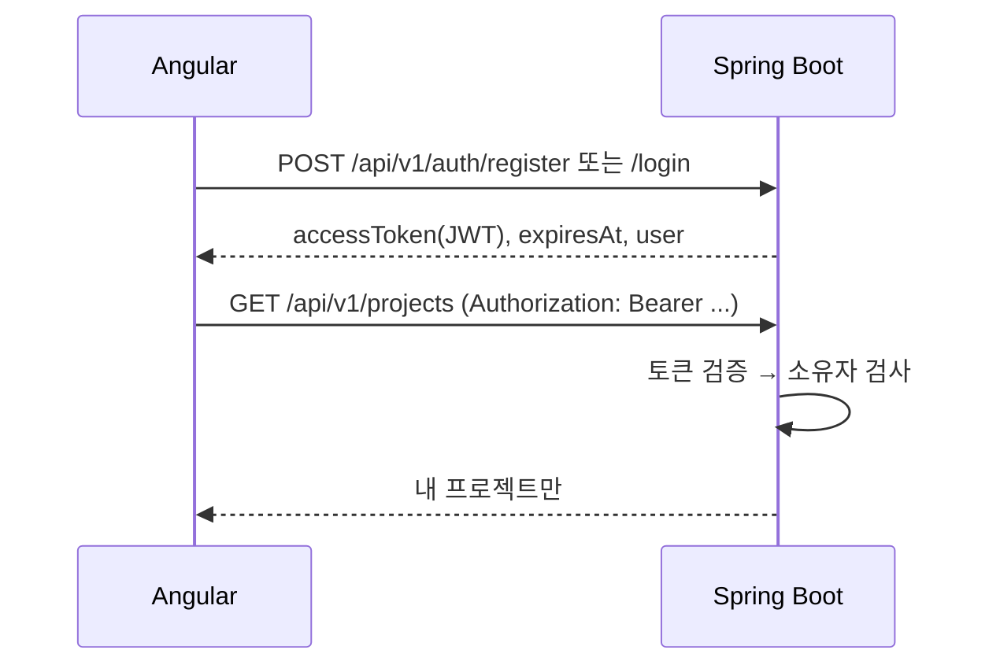

# 인증 스펙 (JWT)

> 기준: 기획서 v1.3 §7.1 (인증/인가 JWT), §13 (보안), 정본 MVP Must

## 흐름

## API

| 메서드 | 경로 | 인증 | 설명 |
|--------|------|------|------|
| POST | `/api/v1/auth/register` | 없음 | `{email, password, displayName, acceptTerms}` → 토큰. 약관 동의 필수, 이메일 중복 409 |
| POST | `/api/v1/auth/login` | 없음 | `{email, password}` → 토큰. 실패 401, 정지된 계정 403 |
| GET | `/api/v1/auth/me` | 필요 | 현재 사용자. 관리자 여부(`admin`), 현재 약관 동의 여부(`termsAccepted`) 포함 |

커뮤니티 읽기([api-v1.md](api-v1.md)의 🌐)와 아래 공개 메일 인증 API를 뺀 그 밖의 `/api/v1/**`는 모두 인증이 필요합니다. 토큰이 없거나 만료되면 401(ProblemDetail)입니다. 정지와 관리자는 [moderation.md](moderation.md)에 있습니다.

## 결정

| 항목 | 결정 | 이유 |
|------|------|------|
| 토큰 | HS256 JWT, 기본 12시간 (`JWT_TTL`) | 서비스 하나가 발급·검증하므로 대칭키로 충분 |
| 리프레시 토큰 | 두지 않음 | MVP 범위. 만료되면 다시 로그인 |
| 비밀 키 | `JWT_SECRET` (32바이트 이상, 짧으면 시작 실패). 비우면 시작할 때 무작위 생성하고 경고 로그 | 저장소에 기본 키를 넣지 않기 위해. 무작위 키는 재시작하면 기존 토큰이 무효가 되므로 **운영에서는 반드시 지정** |
| 비밀번호 | BCrypt, 8~72바이트 | BCrypt가 72바이트까지만 처리 |
| 이메일 | 앞뒤 공백 제거, 소문자로 저장 | 대소문자 중복 가입 방지 |
| 소유자 검사 | `OwnershipInterceptor`가 경로 변수 `{projectId}`, `{chapterId}`로 일괄 검사. 주인과 초대를 수락한 참여자만 통과 (`ProjectAccess`) | 새 엔드포인트에서 검사를 빠뜨리지 않도록. 삭제·설정·게시·초대는 서비스가 주인인지 다시 확인 |
| 작품·게시글 수정 권한 | 서비스에서 작성자인지 확인. 아니면 404 | 경로 변수로 일괄 검사할 수 없는 공개 리소스 |
| 정지·삭제된 계정의 토큰 | `AccountGuardInterceptor`가 쓰기 요청마다 확인 | JWT는 만료 전까지 유효하므로 |
| 다른 사용자의 리소스 | 403이 아니라 **404** | 존재 여부를 알려 주지 않기 위해 |
| 프론트 토큰 저장 | `localStorage` | 새로고침 유지. XSS에 노출되는 대신, 입력값을 HTML로 넣지 않는 Angular 기본 이스케이프와 짧은 만료로 완화 |

## 기존 데이터

인증 도입 전에 만든 프로젝트는 `owner_id`가 비어 있어 **어떤 사용자에게도 보이지 않습니다.** 개발 데이터뿐이라 옮기지 않았습니다. 지우려면 `docker compose down -v`로 초기화합니다.

## 기획서 §8 구조에 추가한 폴더

기획서 §8은 인증 코드의 위치를 `core/auth`(프론트)만 정하고 있어, 아래 폴더를 추가했습니다.

| 폴더 | 내용 | 이유 |
|------|------|------|
| `storyforge-backend/.../domain/user/` | 사용자 엔티티 | §8.2 domain에 사용자가 없음 |
| `storyforge-backend/.../service/auth/` | 가입·로그인·토큰 발급 | §8.2 service에 인증이 없음 |
| `storyforge-frontend/src/app/features/auth/` | 로그인·가입 화면 | `core/auth`는 싱글톤 서비스 전용 (§8.1) |

## SMTP 이메일 인증·비밀번호 재설정 (2026-11-10)

사용자 요청으로 SMTP 기능을 구현했습니다. 기본 비활성(`MAIL_ENABLED=false`)이며 기존 가입·로그인에는 이메일 인증을 강제하지 않습니다. 계정 설정에서 인증 메일을 요청하고 로그인 화면에서 비밀번호 재설정으로 이동합니다. `UserResponse.emailVerified`는 인증 완료 여부입니다. 관리자 지정은 기존 `ADMIN_EMAILS` 정책을 유지하며, 관리자 계정을 먼저 확보하고 이메일 소유권을 확인해야 합니다.

| 메서드 | `/api/v1/auth/mail` 아래 경로 | 인증 | 계약 |
|---|---|---|---|
| GET | `/status` | 없음 | `{enabled}` |
| POST | `/reset-request` | 없음 | `{email}`. 가입 여부와 무관하게 같은 안내 응답 |
| POST | `/verify-request` | 필요 | 로그인 계정의 이메일로 인증 링크 요청 |
| POST | `/verify` | 없음 | `{token}`. 일회용 인증 링크 소비 |
| POST | `/reset` | 없음 | `{token,password}`. 비밀번호 재설정과 기존 JWT 폐기 |

- 토큰: SecureRandom 32바이트, URL-safe Base64 43자. DB에는 SHA-256 해시만 보관합니다. 인증은 24시간, 재설정은 30분 유효합니다.
- 같은 사용자·목적의 발송 간격은 60초입니다. 재발급하면 이전 링크를 폐기합니다. IP별 인증 API 요청 제한도 적용합니다.
- 사용자 행 잠금으로 재발급·소비를 직렬화합니다. 계정 낙관적 잠금은 동시 프로필 변경이 비밀번호를 덮어쓰는 것을 막습니다.
- 비밀번호 변경과 재설정은 `credentialVersion`을 올립니다. JWT의 `cv`를 매 요청 DB와 비교하여 이전 토큰을 거부합니다. 기존 `cv` 없는 토큰은 버전 0으로 취급합니다. 계정 삭제 후에도 읽기·쓰기 모두 기존 토큰이 거부됩니다.
- 기존 비밀번호 변경 화면도 완료 후 로그아웃합니다. 메일 복구 요청에는 기존 JWT를 붙이지 않아 폐기된 세션으로도 재설정할 수 있습니다.
- 메일 링크는 설정된 `FRONTEND_ORIGIN`과 fragment를 사용합니다. 페이지 진입 시 fragment를 주소에서 지우고 버튼을 눌렀을 때 POST로 소비합니다. GET이나 메일 미리보기는 토큰을 소비하지 않습니다.
- 미설정은 503, 잘못된 입력은 400, 만료·재사용·목적 불일치는 409입니다. SMTP 발송 실패는 토큰을 제거하고 공개 응답을 동일하게 유지하며 오류 종류만 로그에 남깁니다. 동기 SMTP 전송으로 인한 응답 시간 차이까지 감추지는 않습니다.
- 새 환경 변수와 로컬 수신 검증은 [메일 가이드](../guidance/account-mail.md)를 참고합니다. 외부 메일 발송은 수행하지 않았습니다.
