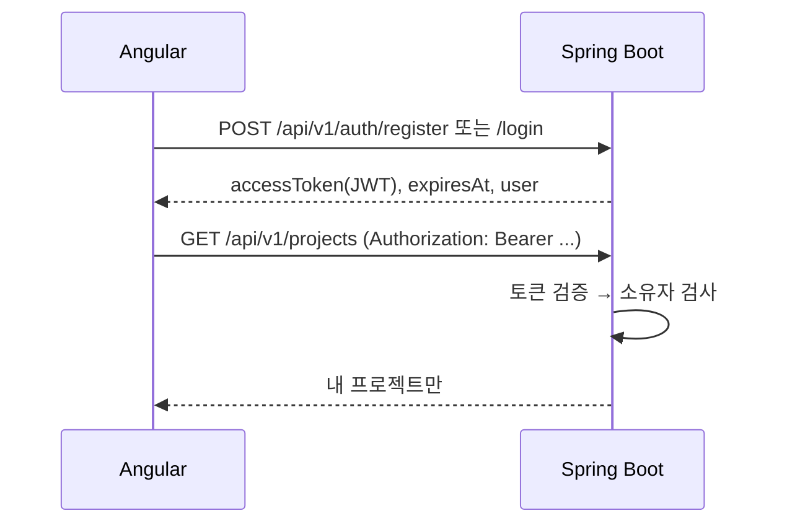

# 인증 스펙 (JWT)

> 기준: 기획서 v1.3 §7.1 (인증/인가 JWT), §13 (보안), 정본 MVP Must

## 흐름

## API

| 메서드 | 경로 | 인증 | 설명 |
|--------|------|------|------|
| POST | `/api/v1/auth/register` | 없음 | `{email, password, displayName, termsAccepted:true}` → 토큰. 이메일 중복 409. 약관 미동의 400 |
| POST | `/api/v1/auth/login` | 없음 | `{email, password}` → 토큰. 실패 401 |
| GET | `/api/v1/auth/me` | 필요 | 현재 사용자 |

그 밖의 `/api/v1/**`는 모두 인증이 필요합니다. 토큰이 없거나 만료되면 401(ProblemDetail)입니다.

## 결정

| 항목 | 결정 | 이유 |
|------|------|------|
| 토큰 | HS256 JWT, 기본 12시간 (`JWT_TTL`) | 서비스 하나가 발급·검증하므로 대칭키로 충분 |
| 리프레시 토큰 | 두지 않음 | MVP 범위. 만료되면 다시 로그인 |
| 비밀 키 | `JWT_SECRET` (32바이트 이상, 짧으면 시작 실패). 개발에서 비우면 시작할 때 무작위 생성하고 경고 로그. `prod` 프로필에서는 비우면 시작 실패 | 저장소에 기본 키를 넣지 않기 위해. 무작위 키는 재시작하면 기존 토큰이 무효 |
| 비밀번호 | BCrypt, 8~72바이트 | BCrypt가 72바이트까지만 처리 |
| 이메일 | 앞뒤 공백 제거, 소문자로 저장 | 대소문자 중복 가입 방지 |
| 소유자 검사 | `OwnershipInterceptor`가 경로 변수 `{projectId}`, `{chapterId}`로 일괄 검사 | 새 엔드포인트에서 검사를 빠뜨리지 않도록 |
| 다른 사용자의 리소스 | 403이 아니라 **404** | 존재 여부를 알려 주지 않기 위해 |
| 프론트 토큰 저장 | `localStorage` | 새로고침 유지. XSS에 노출되는 대신, 입력값을 HTML로 넣지 않는 Angular 기본 이스케이프와 짧은 만료로 완화 |

## 기존 데이터

인증 도입 전에 만든 프로젝트는 `owner_id`가 비어 있어 **어떤 사용자에게도 보이지 않습니다.** 개발 데이터뿐이라 옮기지 않았습니다. 지우려면 `docker compose down -v`로 초기화합니다.

## 기획서 §8 구조에 추가한 폴더

기획서 §8은 인증 코드의 위치를 `core/auth`(프론트)만 정하고 있어, 아래 폴더를 추가했습니다.

| 폴더 | 내용 | 이유 |
|------|------|------|
| `storyforge-backend/.../domain/user/` | 사용자 엔티티 | §8.2 domain에 사용자가 없음 |
| `storyforge-backend/.../service/auth/` | 가입·로그인·토큰 발급 | §8.2 service에 인증이 없음 |
| `storyforge-frontend/src/app/features/auth/` | 로그인·가입 화면 | `core/auth`는 싱글톤 서비스 전용 (§8.1) |
